# CMPE 273 Module 6: Service Discovery, Readiness, and Pod Replacement

A small Kubernetes lab on Docker Desktop. An **Inventory** service runs as 2 replicas behind a Kubernetes **Service**, and a **client** Pod calls it by Service name (`http://inventory:8080/`), never by Pod IP. The lab demonstrates service discovery, readiness probes, and Pod replacement.

## Architecture

```
            Docker Desktop Kubernetes  (single node: docker-desktop)
 +---------------------------------------------------------------------+
 |                                                                     |
 |   client Pod                                                        |
 |   (Deployment "client")                                             |
 |        |                                                            |
 |        | 1. DNS lookup "inventory"  -->  CoreDNS  -->  ClusterIP    |
 |        | 2. GET http://inventory:8080/  (new connection each time)  |
 |        v                                                            |
 |   Service "inventory"   (ClusterIP, port 8080)                      |
 |        |  selector: app=inventory                                   |
 |        |  kube-proxy sends each connection to one READY Pod         |
 |        |                                                            |
 |        +-------------------+--------------------+                   |
 |                            |                    |                   |
 |                            v                    v                   |
 |                   inventory Pod A       inventory Pod B             |
 |                   (readiness: /ready)   (readiness: /ready)         |
 |                            ^                    ^                   |
 |                            +---------+----------+                   |
 |                                      |                              |
 |                     Deployment "inventory" (replicas: 2)            |
 |                     -> ReplicaSet -> Pods                           |
 +---------------------------------------------------------------------+
```

- The **Deployment** manages a ReplicaSet that keeps 2 inventory Pods running.
- The **Service** gives those Pods one stable name and ClusterIP. It routes only to Pods that match its selector **and** are ready.
- The **client** is itself a Pod (1-replica Deployment) inside the cluster, because Service names resolve only through the cluster's DNS.

## Repository layout

| Path | Purpose |
|---|---|
| `inventory/app.py`, `inventory/Dockerfile` | Inventory service (Python stdlib, no dependencies) |
| `client/client.py`, `client/Dockerfile` | Client that calls the Service once per second |
| `k8s/deployment.yaml` | Inventory Deployment: 2 replicas and the readiness probe |
| `k8s/service.yaml` | ClusterIP Service `inventory` |
| `k8s/client.yaml` | Client Deployment (1 replica) |
| `evidence/` | Screenshots referenced below |

### Inventory API

| Endpoint | Behavior |
|---|---|
| `GET /` | `200` with JSON including `pod_name` (the container's hostname, which Kubernetes sets to the Pod name) |
| `GET /health` | always `200` |
| `GET /ready` | `200` when ready, `503` when not ready |
| `POST /ready/fail` | marks **this Pod** not ready (in-memory flag) |
| `POST /ready/restore` | marks this Pod ready again |

The readiness endpoint returns `503`, not `200` with a flag in the body, because the kubelet's probe looks only at the HTTP status code (200-399 is success).

## Deployment instructions

**Prerequisites:** Docker Desktop with Kubernetes enabled (Settings > Kubernetes, kubeadm), `kubectl`, and the `docker-desktop` context.

```bash
kubectl config current-context        # docker-desktop
kubectl get nodes                     # one node, Ready
```

**Deploy:**

```bash
# 1. Build the images. Docker Desktop's cluster uses the local Docker image store.
docker build -t inventory:1 inventory/
docker build -t client:1 client/

# 2. Create the Deployment, Service, and client.
kubectl apply -f k8s/

# 3. Wait for both Deployments.
kubectl rollout status deployment/inventory
kubectl rollout status deployment/client

# 4. Verify.
kubectl get pods -o wide
kubectl get svc inventory
kubectl logs deploy/client --tail=15
```

The images use an explicit `:1` tag with `imagePullPolicy: IfNotPresent`. With `:latest`, Kubernetes would default to pulling from a registry, which fails for images that exist only locally.

**Tear down:**

```bash
kubectl delete -f k8s/
```

**Optional: run the inventory service locally without a cluster:** `python3 inventory/app.py`. Set `PORT=8081` if port 8080 is busy.

### Helper commands used in the screenshots

```bash
# Per-endpoint readiness as the Service sees it
eps() { kubectl get endpointslices -l kubernetes.io/service-name=inventory \
  -o jsonpath='{range .items[*].endpoints[*]}{.targetRef.name}  ip={.addresses[0]}  ready={.conditions.ready}{"\n"}{end}'; }

# Requests per replica over a time window of the client's log
counts() { kubectl logs deploy/client --since="$1" | grep -o 'served by .*' | sort | uniq -c; }

# Toggle readiness on one specific Pod (the flag lives in that Pod's memory)
kubectl exec <pod> -- python -c "import urllib.request as u; print(u.urlopen(u.Request('http://localhost:8080/ready/fail', method='POST')).read().decode())"
kubectl exec <pod> -- python -c "import urllib.request as u; print(u.urlopen(u.Request('http://localhost:8080/ready/restore', method='POST')).read().decode())"
```

## Evidence

### 1. Deploy the application

**Both Pods are running.** The two inventory Pods and the client Pod are all `1/1 Running`, each with its own IP.

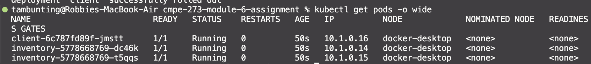

**The Service exposes the replicas.** `inventory` is a ClusterIP Service with its own virtual IP, separate from the Pod IPs.

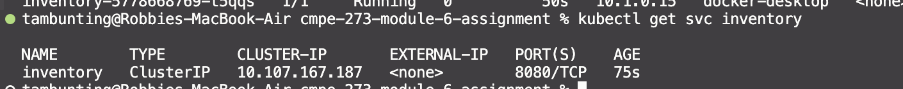

**The Service's endpoints are exactly the two inventory Pods.** `10.1.0.15` and `10.1.0.14` match the Pod IPs above. The client's IP (`10.1.0.16`) is not included, because it does not match the selector.

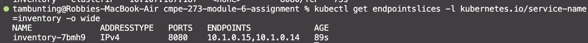

**The client uses the Service name.** The client is configured with `http://inventory:8080/`, and the name resolves via cluster DNS to the Service's ClusterIP (`10.107.167.187`, matching the Service above).

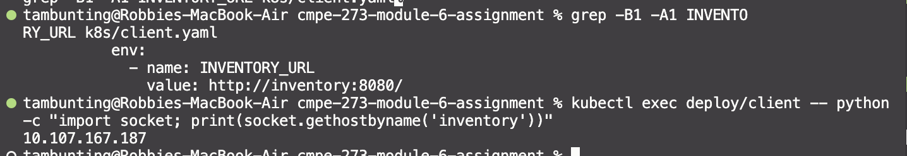

**Requests reach more than one replica.** The client's log shows responses from both `dc46k` and `t5qqs`. Over the last 40 requests, 23 went to one Pod and 17 to the other. The split is uneven because kube-proxy picks a Pod at random per **connection**. The client opens a new connection for every request, so it is not pinned to one replica by keep-alive.

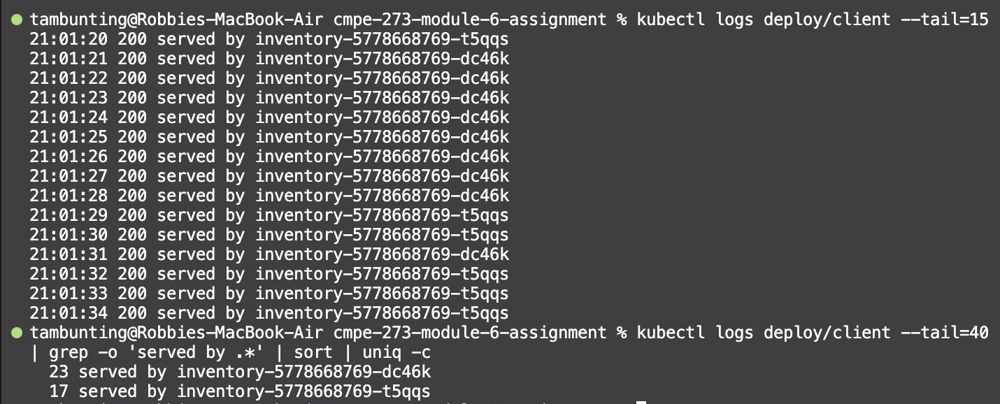

### 2. Readiness test

The probe is on the `inventory` container in the Deployment's Pod template:

```yaml
readinessProbe:
  httpGet:
    path: /ready
    port: 8080
  initialDelaySeconds: 1
  periodSeconds: 2
  failureThreshold: 1
```

**Make one Pod fail readiness.** `POST /ready/fail` was sent to Pod `dc46k` only, using `kubectl exec` so it targets that specific Pod.

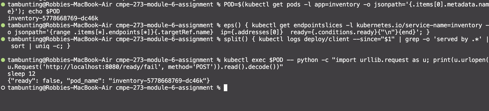

**The Pod is still running, but the Service no longer counts it as ready.** `dc46k` shows `0/1 Running` with `RESTARTS 0`. It was not killed or restarted. Its endpoint is `ready=false`, while `t5qqs` stays `ready=true`.

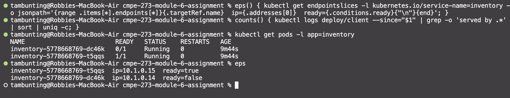

**The unready Pod stops receiving traffic; the other Pod keeps serving.** All 10 client requests in the window were served by `t5qqs`, and none by `dc46k`.

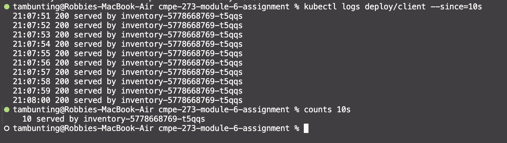

**Restore readiness.** After `POST /ready/restore`, both Pods are `1/1` and both endpoints are `ready=true`. `dc46k` is serving again (6 of the last 10 requests), and its restart count is still `0`, so it is the same container that came back.

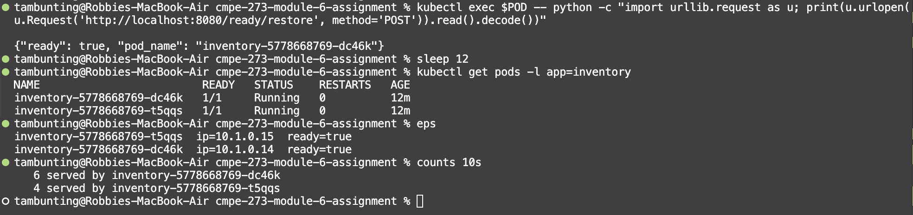

### 3. Pod failure and recovery

**Before:** two inventory Pods (`dc46k` at `10.1.0.14`, `t5qqs` at `10.1.0.15`) and the Service `inventory` at `10.107.167.187`.

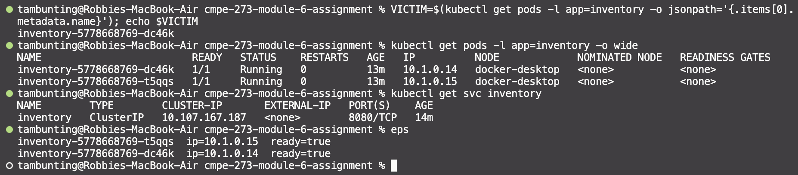

**Delete one Pod.** `kubectl delete pod inventory-5778668769-dc46k` was run while the client kept running. Kubernetes had already created a replacement, `65x9x`, which was `Running` at 15 seconds old. It has a **different name and IP** (`10.1.0.17`). The deleted Pod shows `Terminating`.

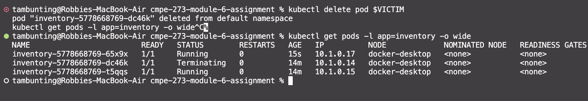

**After recovery.** The Service name and ClusterIP are unchanged (`inventory`, `10.107.167.187`). The endpoints now list `t5qqs` and the new `65x9x`. The client logged **0 errors** over the following 40 seconds and kept receiving `200`s (26 from the replacement, 14 from the surviving Pod), without any change to its configuration.

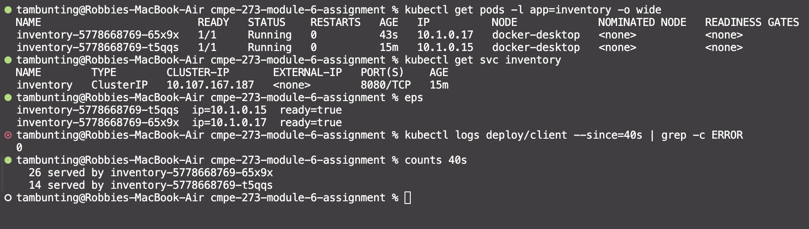

## Observations and caveats

- **Load balancing is random per connection, not round-robin.** Counts between replicas are uneven but both are served. A client that reuses one keep-alive connection would stick to a single Pod.
- **An unready Pod stays in the EndpointSlice** with `ready=false`. The Service routes only to endpoints marked `ready=true`. The older `kubectl get endpoints` hides unready Pods, which makes it look as though they were removed.
- **Readiness vs liveness:** a failing readiness probe only removes a Pod from traffic. A failing liveness probe would restart the container. This lab uses readiness only, and `RESTARTS` stayed `0` throughout.
- **Deleted Pods linger as `Terminating`** for up to about 30 seconds. The Python server runs as PID 1 and does not handle SIGTERM, so Kubernetes waits out the default grace period. Kubernetes marks a terminating Pod's endpoint `ready=false` (seen in an earlier test run), so it does not receive new traffic during that time.
- **"0 errors" means none were observed in this run.** It was one trial on an idle single-node cluster, not a guarantee of zero downtime.

## Reflection

**Why is a stable Service name useful when Pods can fail or be replaced?**

Pods fail and are constantly replaced in a Kubernetes cluster by new Pods with different IP addresses. A stable Service name resolves to a fixed IP address that a client can use to communicate with the Pods. With this method, Pods can be easily replaced, removed, or added without the client having to keep track of them.
